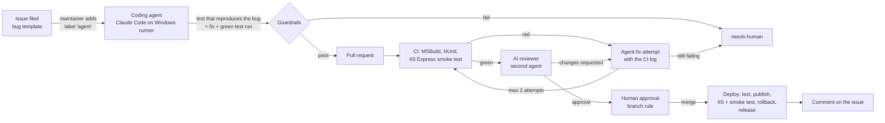

# Agentic SDLC demo: legacy ASP.NET maintenance on autopilot

A working pipeline that maintains a legacy ASP.NET MVC 5 / .NET Framework 4.8 app with AI agents. Someone files an issue, a coding agent opens a pull request, automated checks and an AI reviewer gate it, and a human only approves the merge. Deploy and release happen on their own.

The app, **ClaimsAudit**, is a small billing-compliance tool: it checks medical claims against audit rules and shows the flags. It is written the way real legacy code is (static classes, `ViewBag`, jQuery, an old-style csproj) and ships with a few real bugs, so the agents have something to do.

## The flow



1. **Intake.** Anyone files a bug with the issue form (what happens, what should happen, steps, acceptance criteria). A collaborator adds the `agent` label. Labels from people without repo access are ignored, so strangers cannot spend the API budget.
2. **Coding agent** ([agent.yml](.github/workflows/agent.yml)). Claude Code runs headless on a Windows runner with MSBuild. It must first write an NUnit test that fails because of the bug, then fix the code and get the full build green. Its tools are limited to reading and editing files, running `scripts/test.ps1`, and `git diff`/`git status`. It has no GitHub token: the workflow commits, pushes and opens the PR. If the issue is unclear or needs a business decision, the agent stops and says so instead of guessing.
3. **Guardrails** ([guardrails.ps1](scripts/guardrails.ps1)), checked before anything is pushed: no edits to `.github/`, `scripts/` or `CLAUDE.md`, a diff under 400 lines, and a changed test for every fix.
4. **CI** ([ci.yml](.github/workflows/ci.yml)): restore, MSBuild, NUnit, then the site is started in IIS Express and smoke-tested. Result: status `ci/build-and-test`.
5. **AI review** ([ai-review.yml](.github/workflows/ai-review.yml)): a second agent reviews the diff for correctness, test quality and scope, posts the review on the PR and sets `ci/ai-review`. Its instructions are always read from `main`, so a PR cannot rewrite its own review rules.
6. **Retry loop.** A red CI run or a blocking review sends the PR back to the agent with the log or the review. After two failed attempts the PR is labelled `needs-human`.
7. **Human approval.** A branch rule on `main` requires both statuses and one approving review. The agent's PRs are authored by `github-actions[bot]`, so the maintainer can approve them.
8. **Deploy** ([deploy.yml](.github/workflows/deploy.yml)): after the merge, a GitHub runner tests again, publishes and smoke-tests the published build. A self-hosted runner on the Windows server backs up the live site, deploys to IIS behind `app_offline.htm`, smoke-tests it in place and restores the previous version if that fails. Then the release is created and the original issue gets a comment with the link. A failed deploy opens a `needs-human` issue.

The app runs at **http://213.155.29.61**.

## Why it is built this way

- **Prove the bug before fixing it.** A fix without a failing test is a guess. The most common failure of agent fixes is "the tests pass, but it is still broken in production", so the test has to reproduce the reported behaviour.
- **The agent never holds credentials.** All GitHub actions are deterministic workflow steps after the guardrails, so a confused or prompt-injected agent cannot push to `main`, change CI or leak secrets.
- **Bounded autonomy.** Turn limits, a retry cap and a diff limit keep cost and blast radius small. Anything unusual goes to a person with an explanation.
- **Right-sized.** The legacy app gets characterization tests and a smoke test, which is enough of a safety net to automate maintenance, not a rewrite.

One GitHub-specific detail: PRs opened with `GITHUB_TOKEN` do not trigger other workflows, so each stage starts the next one explicitly (`gh workflow run`) and reports a commit status that the branch rule requires. CI and AI Review are therefore dispatch-only; for a PR opened by a person, run them from the Actions tab with the branch name and the PR number.

## Setup

1. Add the repository secret `ANTHROPIC_API_KEY` (Settings → Secrets and variables → Actions).
2. Settings → Actions → General → Workflow permissions: **Read and write**, and tick **Allow GitHub Actions to create and approve pull requests**.
3. Add a ruleset for `main`: require a pull request with 1 approval, and require the status checks `ci/build-and-test` and `ci/ai-review`.
4. On the Windows server: enable IIS with ASP.NET 4.8, create the `ClaimsAudit` site on `C:\inetpub\claimsaudit`, and register a self-hosted runner for this repository with the label `claimsaudit-prod`, running as a service.
5. Settings → Actions → General → fork pull request workflows: **Require approval for all external contributors**, so code from outside the repo never reaches the self-hosted runner without a review.
6. File a bug with the issue form and add the `agent` label.

Running locally (Windows, Visual Studio 2022+ with the ASP.NET workload):

```
pwsh -File scripts/test.ps1
pwsh -File scripts/smoke.ps1
```

## The same thing on Azure DevOps

| Here (GitHub) | Azure DevOps |
|---|---|
| Issue form + `agent` label | Work item template + tag, Service Hook on "work item updated" |
| `agent.yml` on a Windows runner | Pipeline with `resources: webhooks`, Windows agent pool |
| Commit status `ci/build-and-test` | Build validation branch policy |
| Commit status `ci/ai-review` | Status check policy fed by the PR Status API |
| Ruleset: 1 approval | Minimum number of reviewers policy |
| `gh workflow run` hand-offs | Pipeline completion triggers / REST queue calls |
| Self-hosted runner deploys to IIS, smoke test, rollback | Deployment group / environment agent on the IIS box, or an App Service staging slot with smoke test and swap |
| `ANTHROPIC_API_KEY` secret | Variable group linked to Key Vault |

The agent prompts, guardrails and test scripts carry over unchanged. Only the YAML and the triggers differ.

## Limits

- "Production" is a single IIS server with a short `app_offline.htm` window during the copy. A setup with real users would deploy to a staging slot or a second server and switch traffic only after the smoke test.
- The self-hosted runner only runs the deploy job, which is triggered by pushes to `main`; everything that builds untrusted code runs on GitHub's runners.
- The AI reviewer is a gate, not a replacement for the human approval.
- The app keeps its data in memory; it exists to give the agents realistic legacy code to work on.
